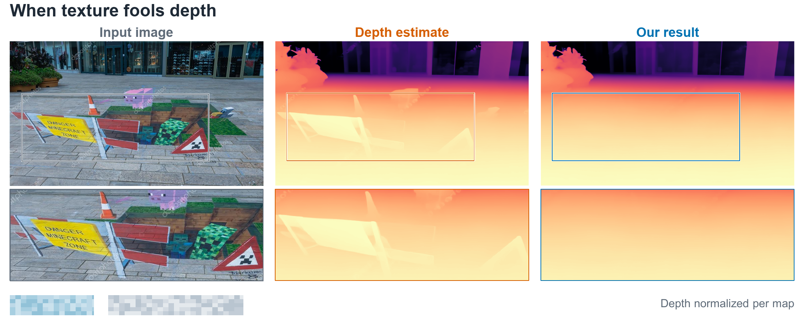
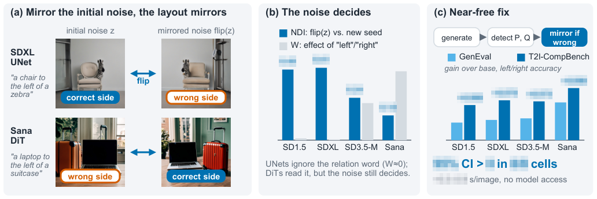
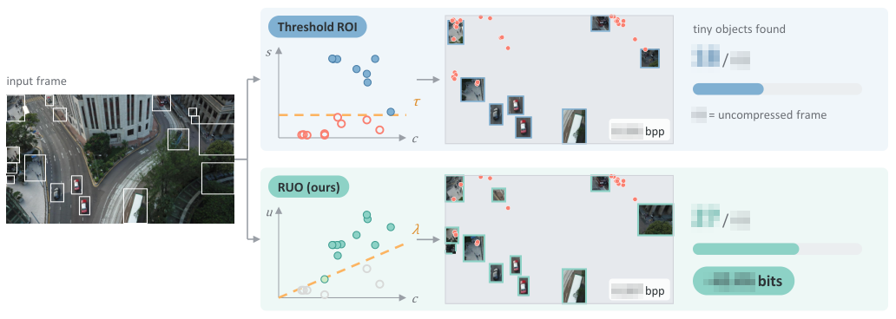

# BeBubble

Ph.D. student. This site collects research notes, learning resources, and small experiments.

## Research Interests

### Trustworthy and secure AI

Robustness and evaluation of vision-language and large language models, federated learning security, and watermarking.

When texture fools depth

Surface patterns can look like real geometry. We study how visual illusions mislead depth estimation and how to make visual perception more reliable.

### Generative computer vision

Diffusion-based image and video synthesis, with an emphasis on training-free and plug-and-play adaptation.

Left, right, and the noise in between

Text-to-image models often place objects on the wrong side. It turns out the prompt is not always what decides, and the fix can be surprisingly cheap.

### Multimodal understanding

Clinical video understanding and visual reasoning.

### Reliability and efficiency of vision systems

Compressing images for machines, not eyes

When the viewer is a detector rather than a person, the bits should go somewhere else, especially for the smallest objects in a drone's view.

## Tools

PyTorch, SciPy, Connected Papers, and Papers with Code.

## A small diversion

[DOCOMO Parrot Brothers](https://www.youtube.com/watch?v=8gqKzv6nuIk&t=83s)
